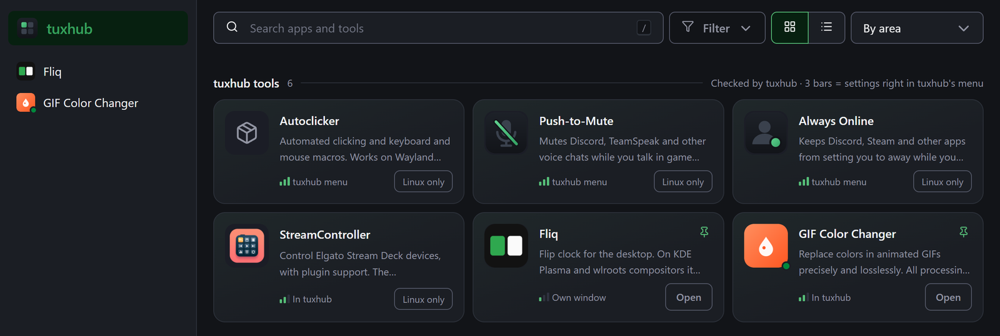
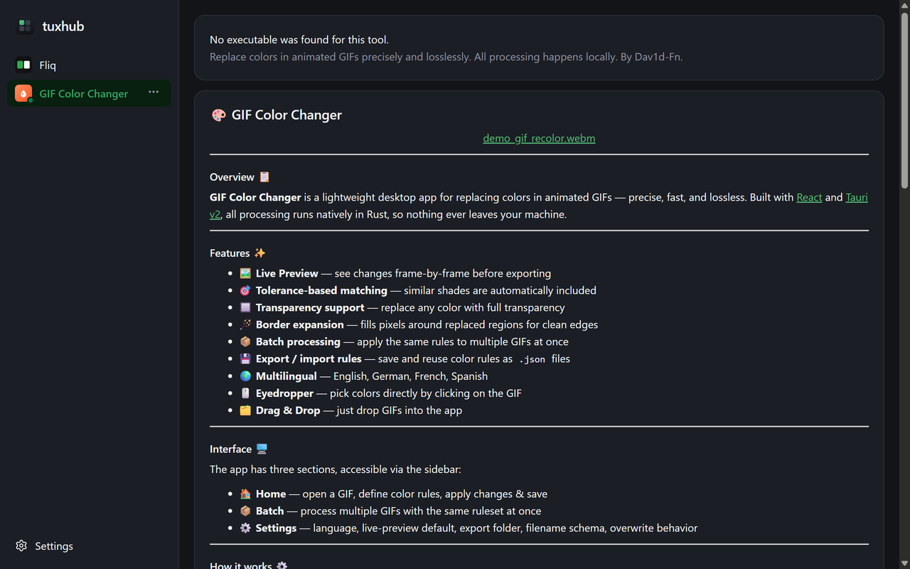
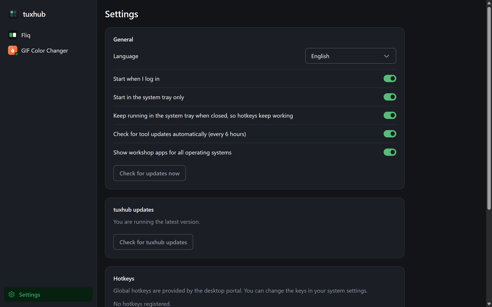
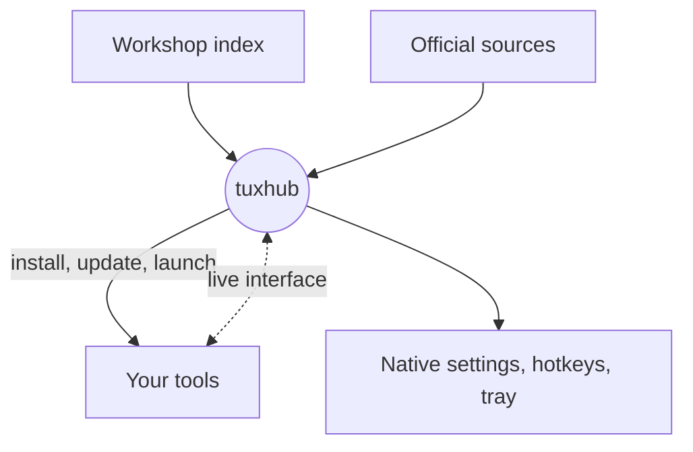

<p align="center">
  
</p>

<p align="center">
  <a href="https://github.com/SirSnolte/tuxhub/releases/latest"></a>
  <a href="https://github.com/SirSnolte/tuxhub/releases"></a>
  <a href="LICENSE"></a>
  <br>
  
  
  
</p>

<p align="center">
  <b><a href="#-download">Download</a></b> ·
  <a href="#-features">Features</a> ·
  <a href="#%EF%B8%8F-screenshots">Screenshots</a> ·
  <a href="#-for-app-developers">For developers</a> ·
  <a href="#%EF%B8%8F-building-from-source">Build</a>
</p>

<br>

<p align="center">
  <a href="assets/readme/tuxhub-preview.mp4">
    
  </a>
  <br>
  <sub>▶ <a href="assets/readme/tuxhub-preview.mp4">Watch the full-quality video</a> (1080p, 20 s)</sub>
</p>

<br>

**tuxhub** installs, updates and launches gaming tools from a curated
workshop, on **Linux and Windows**. Each tool is an independent application
with its own repository. tuxhub downloads it from its official source, keeps
it up to date and lets you use it in its own window or right inside tuxhub,
with settings rendered natively in tuxhub's own design.

<table>
  <tr>
    <td width="33%" valign="top">
      <h3>🧩 One workshop</h3>
      Curated tuxhub tools on top, every other app of your system below,
      grouped by area. One click to install from GitHub releases,
      distribution packages or Flathub.
    </td>
    <td width="33%" valign="top">
      <h3>🔄 Always current</h3>
      Checks its tools, every Flatpak and every distribution package, and
      updates them all with one click. Self-updates are cryptographically
      signed and verified.
    </td>
    <td width="33%" valign="top">
      <h3>🎛️ Native settings</h3>
      Tools describe their settings over a tiny JSON protocol. tuxhub turns
      them into a live settings page: every change applies instantly.
    </td>
  </tr>
  <tr>
    <td width="33%" valign="top">
      <h3>⌨️ Global hotkeys</h3>
      On Wayland through the XDG desktop portal, without reading keyboard
      input; on Windows through the system's hotkey registration.
    </td>
    <td width="33%" valign="top">
      <h3>🛡️ Safe uninstall</h3>
      A preview names exactly what goes. Packages of the system or the
      desktop are never removed; Steam games are uninstalled by Steam.
    </td>
    <td width="33%" valign="top">
      <h3>🐧 + 🪟 Cross-platform</h3>
      The workshop lists the apps for your system. One setting also shows
      the apps of the other system, clearly marked.
    </td>
  </tr>
</table>

## 📥 Download

<table>
  <tr>
    <th>System</th><th>Package</th><th></th>
  </tr>
  <tr>
    <td>🪟 <b>Windows 10, 11</b></td>
    <td><code>tuxhub_*_x64-setup.exe</code></td>
    <td rowspan="4" align="center">
      <a href="https://github.com/SirSnolte/tuxhub/releases/latest"></a>
    </td>
  </tr>
  <tr><td>🐧 <b>Fedora, openSUSE</b></td><td><code>.rpm</code></td></tr>
  <tr><td>🐧 <b>Debian, Ubuntu, Linux Mint</b></td><td><code>.deb</code></td></tr>
  <tr><td>🐧 <b>Other distributions</b></td><td><code>.AppImage</code></td></tr>
</table>

```bash
sudo dnf install ./tuxhub-*.x86_64.rpm      # Fedora
sudo apt install ./tuxhub_*_amd64.deb       # Debian, Ubuntu
```

**Windows:** run the setup program. It installs tuxhub for your user account
without administrator rights. The installer is not code-signed yet, so
Windows SmartScreen asks once: choose *More info*, then *Run anyway*.

From then on tuxhub updates itself. Installing an update of the `.rpm` or
`.deb` package asks for your password once, as for any system package.

<details>
<summary><b>Optional dependencies on Linux</b></summary>

| Feature | Requirement |
|---|---|
| Running applications inside tuxhub | `xpra` (in the repositories of all major distributions) |
| Installing Flatpak applications | `flatpak` |
| Installing distribution packages | `pkexec` (polkit) and dnf, zypper or apt |
| Global hotkeys | A desktop that implements the GlobalShortcuts portal, such as KDE Plasma or GNOME 48 and later |

</details>

## ✨ Features

- **One workshop for every app:** the curated tuxhub tools on top, every
  other app of the start menu below, grouped by area (gaming tools, games,
  communication, media, office, graphics, tools, development, system). Start
  menu entries of one program, such as LibreOffice or Wine, show as one
  family. Apps already on the computer are never installed a second time.
- **Your sidebar:** drag any app into the sidebar and reorder it there, with
  undo. Without a mouse: the pin button, the `P` key and `Alt`+arrow keys.
- **Updates for everything:** tuxhub tools, every Flatpak and every
  distribution package of the start menu, with one password prompt for all
  packages.
- **Run inside tuxhub:** on Linux, standalone applications can run on a
  virtual display and appear inside the tuxhub window. A separate window is
  always available, and on Windows apps always run in their own window.
- **Menus of their own for apps that only share a socket:** for the flip
  clock [Fliq](https://github.com/Dav1d-Fn/Fliq-Desktop-Flipclock), tuxhub
  brings Fliq's whole layout editor (blocks, styles, groups, drag and drop,
  calendars, saved layouts) in tuxhub's design.
- **Tray, autostart and close-to-tray**, so hotkeys keep working when the
  window is closed.
- English and German user interface.

## 🖼️ Screenshots

<table>
  <tr>
    <td colspan="2"></td>
  </tr>
  <tr>
    <td width="50%"></td>
    <td width="50%"></td>
  </tr>
  <tr>
    <td colspan="2" align="center"><sub>Workshop · Tool page · Settings (tuxhub 0.14.0 on Windows 11)</sub></td>
  </tr>
</table>

## ⚙️ How it works



The **workshop index** ([`registry/index.json`](registry/index.json)) names each tool and its **official source**: GitHub releases, Flathub, dnf or apt, or a Windows setup program. Tools that speak the **live interface** (one JSON object per line over a Unix socket or a Windows named pipe) get a native settings page, hotkeys and tray actions in tuxhub.

<details>
<summary><b>The main page in detail</b></summary>

The tuxhub logo opens the main page. It reads the start menu and the local
AppStream data and needs no network, except for the catalog and the update
check.

- **Toolbar:** search by name, description, package, Flatpak ID, source or
  area (`/` or any letter starts it, `Enter` opens the first result); a
  filter for apps in the sidebar, running apps, updates and the three
  integration levels; tiles or a list with details; sorting by area, name,
  integration or source. The view and the folded areas are remembered.
- **Areas:** each app gets an area from its desktop entry; the details let
  you choose another one. Game shortcuts of Steam, Heroic and Lutris are
  listed under Games and are started, updated and uninstalled through their
  store only.
- **Details** open in a drawer: open, update, sidebar, the members of a
  family, the integration level (own window, inside tuxhub, tuxhub menu),
  where an app runs, its area, source and ID, and uninstall.
- **Multiple apps:** `Ctrl`+click selects; selected apps are dragged,
  pinned, updated or uninstalled together.
- **Running instances:** if an app already runs outside tuxhub, starting it
  inside tuxhub asks first, then quits the running instance and starts it in
  the hub. When tuxhub cannot tell whether an app runs (it starts through a
  script or a shared launcher such as a shell), it opens in its own window.
  tuxhub never starts a second instance.
- **Updates:** Flatpaks are updated with `flatpak update` from the remote
  they came from, packages with one `pkexec dnf upgrade` for all of them.
  Running apps are quit after one question and started again. AppImages and
  other programs update themselves. On Debian-based systems packages are
  updated with your package manager.
- **Uninstall:** Flatpaks with `flatpak uninstall` (keeping their data if you
  like), packages with `dnf remove` after a preview of every package that
  would go with them. Packages of the system or the desktop, the ones dnf
  protects and removals of more than 25 packages are refused, and the
  preview is checked again right before removing. AppImages are removed only
  inside your home folder; scripts and web apps are not removed.

</details>

## 🧑‍💻 For app developers

tuxhub is meant to be the place where gaming software feels at home. Any
application can appear in the workshop, and with a few lines of code it can
do much more than start and stop:

- **Live settings:** a running application describes its settings and
  actions over a local socket. tuxhub shows them as a native settings page,
  in its own design, in English and German, and every change takes effect
  immediately. Tabs with icons, presets with color swatches, fields that
  appear only when they matter, a folded "Advanced" part and a reset per
  field are all part of the description.
- **Update-proof:** the application describes its settings itself, at
  runtime. When you add, rename or remove a setting in a new release, the
  page in tuxhub follows without any change on our side.
- **No dependencies:** one JSON object per line on a Unix socket (on
  Windows a named pipe). Any language can implement it; the
  [developer documentation](docs/tool-development.md#live-interface-level-3)
  contains the full protocol and a reference application.

**Getting into tuxhub:**

1. Implement the live interface (protocol 1) in your application, or we
   propose it to you as a pull request.
2. You or we open a pull request that adds the workshop entry: source
   (GitHub release, distribution package or Flathub), icon, description and
   `"live": true`.
3. We review the entry and test it with the current release of your
   application. From then on, every release is picked up automatically.

The live interface is available from tuxhub 0.5.0, its optional additions
(protocol 1.1) from tuxhub 0.6.0.

<details>
<summary><b>Workshop entry format</b></summary>

The workshop index is [`registry/index.json`](registry/index.json). Entries
are reviewed before they are added. Third-party tools are developed by their
respective authors; tuxhub installs them only from their official sources and
does not modify them.

Each entry names the systems it runs on in `platforms` (`"linux"`,
`"windows"`; Linux when missing). `source` is the source older tuxhub
versions read; `sources` and `manifests` add a source and a manifest for a
single system:

```json
{
  "id": "fliq",
  "platforms": ["linux", "windows"],
  "source": { "type": "system-package", "package": "fliq", "rpm": "*.x86_64.rpm", "command": "/usr/bin/desktop-flipclock" },
  "sources": { "windows": { "type": "github-release", "asset": "*_x64-setup.exe" } },
  "manifest": { "embed": false, "live": true },
  "manifests": { "windows": { "embed": false } }
}
```

Proposals for new entries are welcome as issues. Please include the
repository, the source (GitHub release or Flathub) and a short description.

</details>

## 🛠️ Building from source

Requirements: Rust (stable), Node.js 20 or later, and on Linux the WebKitGTK
development files. On Windows, Rust needs the Microsoft C++ Build Tools;
WebView2 is part of Windows 10 and 11.

```bash
# Fedora
sudo dnf install webkit2gtk4.1-devel gtk3-devel libappindicator-gtk3-devel librsvg2-devel
# Debian, Ubuntu
sudo apt install libwebkit2gtk-4.1-dev libgtk-3-dev libayatana-appindicator3-dev librsvg2-dev
```

```bash
npm ci
npm run tauri dev      # development build with live reload
npm run tauri build    # release build and packages
```

Tests and checks:

```bash
cargo test
cargo clippy --all-targets -- -D warnings
npm run check
```

## 🔒 Security

Tools installed through tuxhub run with the permissions of your user account,
like any other application. Please report vulnerabilities as described in
[SECURITY.md](SECURITY.md).

## 🤝 Contributing

See [CONTRIBUTING.md](CONTRIBUTING.md).

## 📄 License

tuxhub is released under the [MIT License](LICENSE). Bundled third-party
components and their licenses are listed in
[THIRD_PARTY_NOTICES.md](THIRD_PARTY_NOTICES.md).

<sub>Linux is a registered trademark of Linus Torvalds. Windows is a
trademark of Microsoft. All other product names are trademarks of their
respective owners. tuxhub is not affiliated with the projects listed in its
workshop.</sub>
